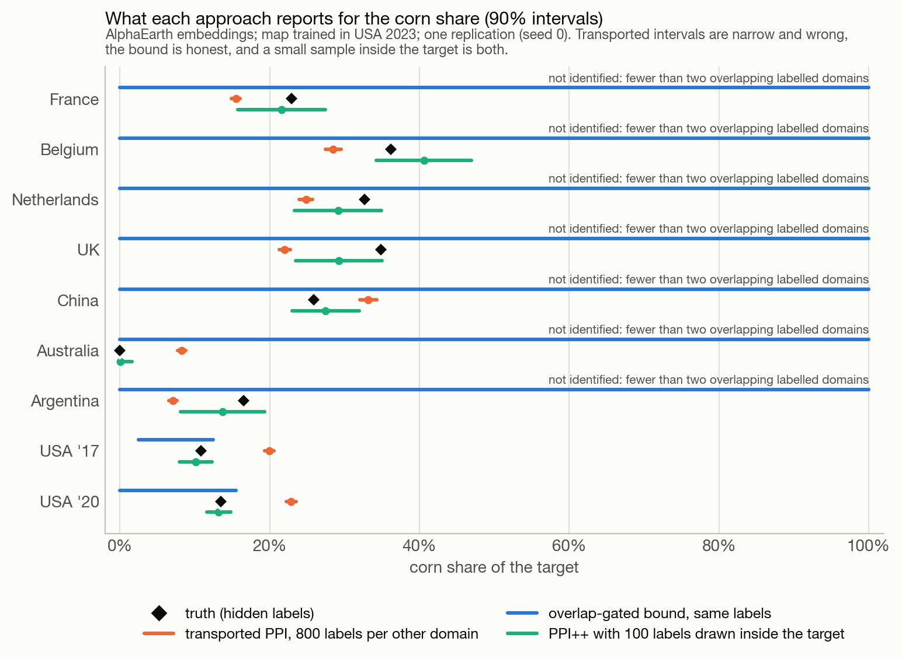

# Zero-overlap PPI

[](https://github.com/rohanbalixz/zero-overlap-ppi/actions/workflows/tests.yml)


**What can crop labels from other countries tell you about a country that has none?**

[Technical note](docs/NOTE.md) · [All results](results/summary.md) ·
[Data: CropGlobe](https://huggingface.co/datasets/x-ytong/CropGlobe) ·
[Cite](#citation)

Prediction-powered inference (PPI) corrects a machine-learning map's bias
using a small labelled sample. The weighted version (Kluger et al., 2025)
allows nonuniform labelling. It requires every unit's labelling probability
to be known and **bounded away from zero** (their Assumption 1(iii)–(iv); part
(iv) is what they call overlap).

Global crop-label inventories break that requirement. Labels exist where
national maps have been published, and everywhere else the labelling
probability is not small: it is **exactly zero**. This repository measures
what that costs. It uses [CropGlobe](https://huggingface.co/datasets/x-ytong/CropGlobe),
the benchmark from Tong & Wang (arXiv:2509.03497).

> **TL;DR.** A PPI correction learned in labelled countries and carried to an
> unlabelled one gives 90% intervals that cover the truth **about 4% of the
> time**, and more labels make it worse. Across countries, feature-space
> overlap is zero, so reweighting cannot help, and an honest bound is the
> whole interval [0, 1]. A random sample of **100 labels inside the target**
> restores about 90% coverage at roughly ±0.05.



## Headline

In the leave-one-domain-out design, a map trained in the USA (2023) is
applied to each of nine targets in turn: seven countries, plus the USA in
2017 and 2020. Every domain except the target is labelled, with 800 labels
per domain and 100 replications. Coverage is for the share of every crop
present in the target, with its Monte Carlo standard error in percentage
points in parentheses. Width is the median interval width.

| method | what it assumes about the target | coverage, AlphaEarth | coverage, harmonic | width, AlphaEarth | width, harmonic |
|---|---|---|---|---|---|
| plug-in (pixel counting) | the map is unbiased there | 0.0% | 0.0% | 0 | 0 |
| transported PPI | the map's bias is the same everywhere | 3.7% (0.3) | 6.0% (0.2) | 0.011 | 0.017 |
| transported stratified | P(truth given prediction) is the same | 2.4% (0.2) | 3.4% (0.3) | 0.011 | 0.013 |
| label shift (BBSE) | P(prediction given truth) is the same | 6.5% (0.4) | 18.5% (0.4) | 0.017 | 0.036 |
| IPW-PPI, estimated propensity | P(truth given features) is the same, and features overlap | 48.6% (0.6) | 25.3% (0.5) | 0.035 | 0.056 |
| transported PPI, overlapping domains only | as above, restricted to look-alike domains | 52.7% (0.8) | 9.0% (0.3) | 0.010 | 0.017 |
| **overlap-gated bound** (this repo) | error rates within the spread seen among overlapping domains | 99.9% (0.0) | 100% (0.0) | 1.000 | 1.000 |
| **PPI++, 100 labels inside the target** | no transport assumption (design-based) | **92.1% (0.1)** | **89.8% (0.1)** | 0.103 | 0.116 |

Every transported method is narrow and wrong. The bound is valid, but
informative only for AlphaEarth across the USA's years (width 0.13). Those
are the only targets that overlap two or more labelled domains and whose map
errors also stay close to those domains' errors. Elsewhere the bound is [0, 1]
or close to it. Numbers come from [`results/summary.md`](results/summary.md)
(section 0), which `make all` regenerates.

**Scope.** This is a measurement study, not a new estimator. The baselines
are standard, and the bound is a standard partial-identification
construction: a hull model whose sharp bounds are linear programs. What the
repository adds is the measurement itself. On a public benchmark where the
hidden labels give the truth, it shows how much each transport assumption
costs when overlap is exactly zero, and what remains valid.

## Findings

1. **Across countries, feature-space overlap is zero, not merely small.** In
   AlphaEarth embeddings, a cross-fitted domain classifier separates China,
   Australia and Argentina from the labelled pool with AUC 1.000, and only
   0.1–0.2% of their pixels fall inside the labelled support. The only
   overlaps are among the USA's own years (53–74% pairwise) and between
   Belgium and the Netherlands (35–39%) ([Figure 1](figures/fig1_overlap.png)).
   This is the positivity reading of the paper's observation that AlphaEarth
   transfers across years (about 96%) but collapses across hemispheres.

2. **Transported corrections fail, and more labels make it worse.**
   Transported PPI coverage falls from 10.8% to about 4% (AlphaEarth) and
   from 23.8% to 4.7% (harmonic) as labels per domain grow from 50 to 1,600
   ([Figure 2](figures/fig2_coverage_vs_labels.png)). The bias stays fixed
   while the interval narrows around it. Pooling all labelled countries even
   makes the USA's other years worse: the worst crop-share error goes from
   0.016 (plug-in) to 0.226.

3. **An honest bound is informative only where overlap exists, and not always
   even then.** The bound assumes each crop's map errors in the target lie
   within δ of a mixture of those seen in overlapping labelled domains. δ is
   calibrated leave-one-domain-out, and the sharp bounds are linear
   programs ([`docs/NOTE.md`](docs/NOTE.md), Propositions 1–3).
   - **AlphaEarth, across years:** the bound is valid and informative (99.8%
     coverage, median width 0.13).
   - **AlphaEarth, across countries:** it is [0, 1], the correct answer when
     the labels carry no information.
   - **Harmonic features:** domains overlap in feature space, but the map's
     error rates still differ, so the bound stays wide. Overlap is necessary,
     not sufficient.
   - **Labels only from the USA and four European countries:** the target's
     own error profile falls outside the calibrated range in 5 of 10 cases.
     That is the predicted failure of region-level exchangeability.

4. **Restoring positivity by design fixes it.** A simple random sample of 100
   target labels gives PPI++ intervals with 92% (AlphaEarth) and 90%
   (harmonic) coverage and mean half-widths of ±0.046 and ±0.057
   ([Figure 4](figures/fig4_design.png)). The gain over labels alone tracks
   map quality:
   - about 1.0× where the map is poor (Argentina, 26% accurate), because the
     tuned λ falls back to the labels;
   - 5–6× where the map is good (USA 2017 and 2020);
   - on average 1.9× for AlphaEarth and 1.2× for harmonic features.

   The intervals use an Agresti–Min small-sample adjustment. The unadjusted
   Wald interval undercovers at small n_T (78–88%), and the tables report it
   too.

5. **Aggregate statistics bound accuracy without any labels.** Given the
   target's exact crop shares (here CropGlobe's sample shares, standing in for
   national statistics), the map's own predictions bound its accuracy in Argentina to
   **[21.9%, 27.0%]** (true 26.2%) and in Australia to [31.8%, 54.6%] (true
   44.9%). Validation in the USA reports 98.5%
   ([Figure 5](figures/fig5_accuracy_bounds.png)).

**Reproduction check.** A 500-tree random forest on AlphaEarth reproduces the
published accuracies:

| transfer | this repo (3 runs) | Tong & Wang (10 runs) |
|---|---|---|
| USA → Australia | 47.60 ± 0.02 | 47.57 (Table 7) |
| USA → Argentina | 25.01 ± 0.22 | 24.82 (Table 7) |
| USA '23 → '17 | 95.50 ± 0.03 | 95.52 (Table 11) |
| USA '23 → '20 | 96.40 ± 0.02 | 96.37 (Table 11) |

## The question this raises

When the labelling probability is zero by history rather than by design,
three routes remain:

* report a partial-identification bound, which is honest but here
  uninformative across countries;
* bring in outside information such as national statistics (finding 5);
* change the design so that the probability becomes positive (finding 4).

The open question is how to combine them. Once a target sample makes the
labelling probability positive, the labelled countries can still help in two
valid ways. They can be used to recalibrate the map before it is rectified
inside the target, as in the leave-one-task-out recalibration of Emmenegger,
Stahler & Podimata (2026). Or they can set the first wave's labelling
probabilities in a two-phase multiwave design, in the spirit of Kluger & Bates
(2026). Which saves more target labels when overlap is zero is not settled
here. Every transported method above is overconfident precisely when it is
wrong.

## Reproduce

```bash
git clone https://github.com/rohanbalixz/zero-overlap-ppi && cd zero-overlap-ppi
make setup     # Python >= 3.9 venv + this package (numpy, scipy, scikit-learn, pandas, matplotlib)
make data      # ~120 MB from Hugging Face, pinned revision, SHA-256 verified
make all       # tests, experiments, figures, results/summary.md (~20 min on a 10-core laptop)
```

| stage | `make` target | script | writes | time* |
|---|---|---|---|---|
| maps and domain classifiers | `prepare` | `experiments/prepare.py` | `results/cache/`, `overlap.csv` | 3 min |
| pairwise positivity diagnostic | `overlap` | `experiments/pairwise_overlap.py` | `pairwise_overlap.csv` | 1 min |
| transport study (no target labels) | `transport` | `experiments/transport.py` | `transport.csv.gz` | 7 min |
| design study (labels inside the target) | `design` | `experiments/design.py` | `design.csv` | 1 min |
| identification table | `population` | `experiments/population.py` | `population.csv` | 2 min |
| reproduction of published accuracies | `reproduce` | `experiments/reproduce.py` | `reproduce.csv` | 2 min |
| figures and summary | `report` | `experiments/report.py` | `figures/`, `summary.md` | 1 min |

\*On a 10-core laptop. Every setting is in
[`experiments/config.py`](experiments/config.py). All seeds are fixed. A
clean re-run reproduces every committed result (to floating-point round-off)
and every figure byte for byte. The unit tests need no data and run in CI on
Python 3.9 (pinned versions, from [`requirements-lock.txt`](requirements-lock.txt))
and 3.12 (latest).

## Layout

```
src/zop/
  data.py         CropGlobe loading (de-duplicated as in the authors' loader), domains, splits
  maps.py         the crop map (gradient boosting; RF for the reproduction check)
  overlap.py      positivity diagnostic: cross-fitted domain classifier, AUC, overlap share
  estimators.py   plug-in, transported PPI / stratified / BBSE / IPW-PPI; in-target PPI, PPI++
  bounds.py       hull-model identified set (LP), δ benchmark, sampling slack, breakdown δ
experiments/      config → prepare → pairwise_overlap → transport → design → population → reproduce → report
tests/            48 tests: the bound contains the truth whenever its assumption holds; sets are nested
                  in δ; label shift is the δ = 0 special case; PPI has nominal coverage without shift;
                  small-sample fix; solver fallbacks
docs/NOTE.md      setup, assumptions, Propositions 1–3 with proofs, protocol, limitations
scripts/          data download pinned to one Hugging Face revision, with SHA-256 checksums
results/          summary.md (every number in this README) and the small tables behind the figures
figures/          the five figures in this README
```

Per-replication tables (`transport.csv.gz`, `transport_summary.csv`, `design.csv`)
and SVG versions of the figures are regenerated by `make all` and are not versioned.

## Limitations

These are stated in full in [`docs/NOTE.md` §6](docs/NOTE.md#6-limitations).

* CropGlobe samples are class-balanced, so the "shares" are shares of the
  benchmark sample, not crop areas.
* The labels are themselves national reference maps.
* The map is trained on one source country.
* There are no coordinates, so spatial dependence is ignored.
* The overlap gate and its threshold τ are choices. They are fixed in advance,
  with a τ = 0.3 variant reported.
* The calibration of δ assumes regions are exchangeable. That assumption is
  exactly what selected label geographies violate.

## References

Tong & Wang (2026), arXiv:2509.03497 · Kluger et al. (2025), arXiv:2501.18577 ·
Kluger & Bates (2026), arXiv:2602.16933 · Kluger, Wang & Lobell (2021), *RSE* 262 ·
Emmenegger, Stahler & Podimata (2026), arXiv:2605.29249 ·
Angelopoulos et al. (2023), *Science* · Angelopoulos, Duchi & Zrnic (2023), PPI++ ·
Lipton, Wang & Smola (2018) · Olofsson et al. (2014) · Agresti & Min (2005) ·
Manski (2003). The full list is in the note.

## Citation

If you use this code or its results, please cite it together with CropGlobe
(Tong & Wang, arXiv:2509.03497). The same metadata is in
[`CITATION.cff`](CITATION.cff).

```bibtex
@software{bali2026zeroppi,
  author  = {Bali, Rohan},
  title   = {Zero-overlap {PPI}: prediction-powered inference when the labelling probability is zero},
  year    = {2026},
  version = {0.1.0},
  url     = {https://github.com/rohanbalixz/zero-overlap-ppi}
}
```

CropGlobe is CC BY 4.0 (Tong & Wang). Code is MIT. Rohan Bali, 2026 ·
[rohanbalixz.github.io/rohan-bali-portfolio](https://rohanbalixz.github.io/rohan-bali-portfolio/)
